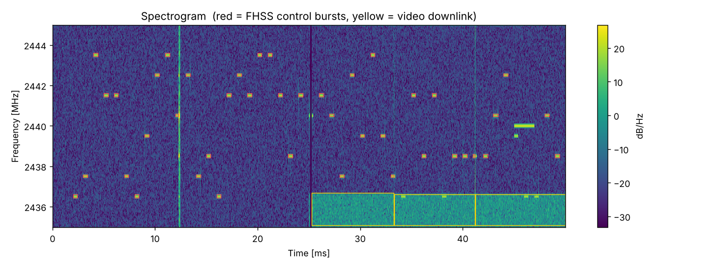
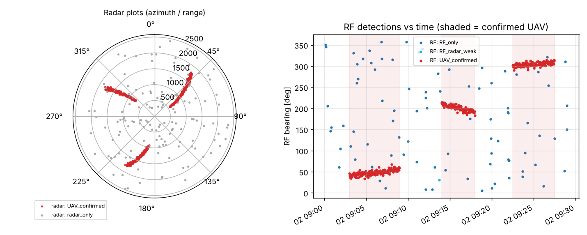

# 🛰️ Anti-Drone Sensor Log Analyzer (ADLA)

> **안티드론(Counter-UAS) 현장의 센서 원시데이터·로그를 자동 분석하는 Python CLI 도구**
> 원시 ADC/IQ 덤프의 이상치(Glitch) 탐지 → FFT 스펙트럼 기반 드론 송신기 식별 → RF·레이더 탐지 융합 → 장비 에러 로그 이상 구간 탐지 → HTML/CSV 리포트 자동 생성

[](https://github.com/taeseokyoon/antidrone-log-analyzer/actions/workflows/ci.yml)
 

| 항목 | 내용 |
|---|---|
| 과목 | 인공지능특론세미나 — 기말 과제 (LLM 코딩 에이전트 활용 실습 프로젝트) |
| 작성자 | 윤태석 (기계IT융합공학 박사과정) |
| 개발 도구 | LLM 코딩 에이전트 **Claude (Claude Code 기반 에이전트)** + Python 3 |
| 과제 주제 분류 | “대용량 센서 덤프 및 장비 에러 로그 분석” 예시를 안티드론 현업 문제로 확장한 자유 주제 |
| 발표 자료 | [`docs/ADLA_presentation.pdf`](docs/ADLA_presentation.pdf) · [`docs/ADLA_presentation.pptx`](docs/ADLA_presentation.pptx) |
| 샘플 리포트 | [`reports/sample_report/report.html`](reports/sample_report/report.html) (다운로드 후 브라우저로 열기) |


---

## 1. 프로젝트 개요

### 1.1 기획 의도
안티드론 체계는 **RF 탐지기, 레이더, 재밍 장비**가 함께 운용되며, 운영 중 다음과 같은 데이터가 쌓입니다.

* RF 수신기의 **원시 IQ/ADC 덤프** (수백 MB ~ 수 GB)
* RF 탐지 로그, 레이더 트랙 로그 (CSV)
* 장비 상태·에러 로그 (텍스트)

현업에서는 “**탐지 누락이나 오경보가 생긴 순간에 센서에 무슨 일이 있었는가**”를 확인하려고 이 파일들을 사람이 직접 열어 봅니다. 예를 들어 ADC 포화(재밍 펄스), DMA 버퍼 언더런, 네트워크 CRC 에러 폭주, 조류·Wi-Fi 오탐 같은 원인을 찾는 일입니다. 이 작업은 시간이 많이 들고 사람마다 결과가 다릅니다.

ADLA는 이 분석을 **명령어 한 줄로 자동화**하고, 결과를 **재현 가능한 HTML/CSV 리포트**로 남기는 것을 목표로 합니다. 작성자의 박사 연구 주제(안티드론 다중 센서 융합 기반 탐지·식별 성능 향상)와 SI 현업(드론 탐지·추적·차단 사업)에 직접 연결되는 도구입니다.

### 1.2 주요 기능

| # | 기능 | 방법 | 출력 |
|---|---|---|---|
| ① | **원시 ADC/IQ 이상치 탐지** | 청크 단위 스트리밍으로 포화(saturation)·임펄스 스파이크·드롭아웃(0 연속)·DC 오프셋 스텝 탐지 | `iq_glitches.csv`, 파형 그래프 |
| ② | **FFT 스펙트럼 분석** | Welch PSD(전체 파일 누적) + Blackman-Harris 스펙트로그램 | `psd.png`, `spectrogram.png` |
| ③ | **드론 송신기 식별** | 시간-주파수 연결 성분 라벨링 → FHSS 제어링크(호핑 채널·버스트 길이·주기)와 광대역 영상링크(중심주파수·대역폭) 자동 추정 | `iq_emissions.csv`, 송신기 요약 표 |
| ④ | **RF–레이더 탐지 융합** | 시간 게이트(±1.5 s) + 방위 게이트(±12°, 0/360° 경계 처리) 연관 → 확인 UAV / 레이더 단독(조류·클러터) / RF 단독(Wi-Fi) 분류 | `uav_events.csv`, `rf_fused.csv`, 융합 그래프 |
| ⑤ | **장비 에러 로그 분석** | 정규식 스트리밍 파싱, 분당 ERROR 건수의 강건 통계(중앙값 + 5·MAD)로 에러 폭주(storm) 구간 탐지, 깨진 라인 격리 | `error_storms.csv`, 타임라인 그래프 |
| ⑥ | **자동 리포트** | KPI 카드 + 그래프 + 표가 들어간 **단일 HTML 파일**(이미지 내장) + `summary.json` | `report.html` |
| ⑦ | **더미 데이터 생성기** | 정답(ground truth)이 기록된 가상 현장 데이터를 생성해 누구나 바로 테스트 가능 | `samples/` |

### 1.3 검증 결과 (샘플 데이터, 정답 대비)

| 항목 | 주입한 정답 | ADLA 분석 결과 |
|---|---|---|
| ADC 글리치 | 포화 1, 드롭아웃 1, 스파이크 2, DC 스텝 1 | **5/5 유형·구간 일치, 오경보 0** |
| FHSS 제어링크 | 8채널(±0.5~±3.5 MHz), 버스트 0.4 ms, 주기 1.0 ms | **8채널 일치**, 버스트 0.41 ms, 주기 1.00 ms |
| 영상 다운링크 | 중심 −4.2 MHz, 대역폭 1.6 MHz | 중심 −4.16 MHz, 대역폭 1.52 MHz |
| 드론 비행(sortie) | 3회 (09:03, 09:14, 09:22:30) | **확인 UAV 트랙 3개**, 시작 시각 오차 < 1 s, 프로토콜 일치 |
| 에러 폭주 | 09:17–09:19 CRC_ERROR | 09:17–09:19, `CRC_ERROR @ LINK-ETH0` |
| 깨진 로그 라인 | 1줄 | 1줄 격리, 나머지 510개 이벤트 파싱 |

**대용량 성능** (1 GB IQ 덤프 = 2.5억 복소 샘플, 클라우드 VM 기준)

| 항목 | 결과 |
|---|---|
| 처리 시간 | 약 83 초 (약 12 MB/s) |
| 최대 메모리(peak RSS) | **207 MB** (memmap 사용 시 1,154 MB → 개선, 5장 참고) |
| 정확도 | 글리치 2,500개 = 500회 × 5유형, **누락·중복 0** |

---

## 2. 시스템 구조

```
          ┌──────────────── samples/ (현장 데이터 또는 더미) ────────────────┐
          │ iq_dump.bin(+json)   rf_detections.csv   radar_tracks.csv   system_error.log │
          └──────┬──────────────────────┬───────────────────────┬───────────────┘
                 ▼                      ▼                       ▼
        iq_analysis.py           log_analysis.py           log_analysis.py
   ┌──────────────────────┐   ┌────────────────────┐   ┌─────────────────────┐
   │ read_chunk (1M 샘플)  │   │ load_detections     │   │ parse_error_log     │
   │ ├ detect_glitches     │   │ fuse()              │   │ (정규식 스트리밍)    │
   │ ├ Welch PSD 누적      │   │  시간·방위 게이트    │   │ find_error_storms   │
   │ └ spectrogram         │   │  → UAV / 클러터 분류 │   │  (median + 5·MAD)   │
   │   → detect_emissions  │   └─────────┬──────────┘   └──────────┬──────────┘
   │   → summarize_emitters│             │                          │
   └──────────┬───────────┘             │                          │
              └──────────────┬──────────┴──────────────────────────┘
                             ▼
                        report.py  →  reports/<out>/report.html + *.csv + summary.json + figures/*.png
```

```
antidrone-log-analyzer/
├── antidrone_analyzer/
│   ├── __main__.py        # CLI (generate / analyze)
│   ├── generator.py       # 더미 데이터 + ground_truth.json 생성
│   ├── iq_analysis.py     # IQ 글리치 탐지, PSD, 스펙트로그램, 송신기 식별
│   ├── log_analysis.py    # 에러 로그 파싱·폭주 탐지, RF-레이더 융합
│   └── report.py          # 그래프·CSV·HTML 리포트
├── samples/               # 바로 실행 가능한 샘플 입력 (2.1 MB)
├── reports/sample_report/ # 샘플 실행 결과 (HTML/CSV/PNG)
├── tests/test_pipeline.py # 정답 대비 자동 채점 테스트 9개
├── docs/                  # 발표자료(PPTX/PDF), 이미지
├── .github/workflows/ci.yml  # GitHub Actions: ruff 린트 + pytest + 샘플 리포트 아티팩트
├── requirements.txt · pytest.ini · ruff.toml
└── README.md
```

---

## 3. 실행 방법

### 3.1 환경 설정
Python 3.10 이상이 필요합니다. (Windows / macOS / Linux 공통)

```bash
git clone https://github.com/taeseokyoon/antidrone-log-analyzer.git
cd antidrone-log-analyzer
python -m venv .venv
# Windows: .venv\Scripts\activate      macOS/Linux: source .venv/bin/activate
pip install -r requirements.txt
```

### 3.2 구동 명령어

```bash
# ① 포함된 샘플 데이터 분석 → reports/latest/report.html
python -m antidrone_analyzer analyze --data samples --out reports/latest

# ② 더미 데이터 새로 생성 (IQ 길이 지정: 0.05 s = 2 MB, 25 s = 1 GB)
python -m antidrone_analyzer generate --out my_data --iq-seconds 0.05

# ③ 개별 파일 지정 + 융합 게이트 조정
python -m antidrone_analyzer analyze --iq my.bin --rf rf.csv --radar radar.csv --log sys.log \
       --dt 2.0 --gate 15 --chunk 2000000 --out reports/site_A

# ④ 테스트 (정답 대비 자동 채점)
pytest -q
```

실행 예시 출력:
```
[ADLA] IQ dump   : samples/iq_dump.bin (2.0 MB) ...
[ADLA]   -> 5 glitch intervals, 2 emitters
[ADLA] RF/radar  : rf_detections.csv + radar_tracks.csv ...
[ADLA]   -> 3 confirmed UAV tracks
[ADLA] Error log : system_error.log ...
[ADLA]   -> 510 events, 1 storms, 1 malformed lines
[ADLA] done in 1.6s -> reports/latest/report.html
```

### 3.3 입력 파일 형식 (샘플 = 더미 데이터)

| 파일 | 형식 |
|---|---|
| `iq_dump.bin` | int16 리틀엔디언, I/Q 인터리브. 메타데이터 `iq_dump.json` (`sample_rate`, `center_freq`, `full_scale`) |
| `rf_detections.csv` | `timestamp, sensor_id, freq_mhz, bandwidth_mhz, rssi_dbm, protocol, bearing_deg` |
| `radar_tracks.csv` | `timestamp, track_id, range_m, azimuth_deg, elevation_m, speed_mps, rcs_dbsm` |
| `system_error.log` | `YYYY-MM-DD HH:MM:SS.mmm [LEVEL] DEVICE CODE detail` |
| `ground_truth.json` | 생성기가 주입한 정답 (테스트 채점용) |

샘플 시나리오: 2.44 GHz ISM 대역 10 Msps 캡처 50 ms, 30분 운용 로그(드론 3회 비행 + 조류 140건 + Wi-Fi 90건 + 2분간 CRC 에러 폭주 + 깨진 로그 1줄)

---

## 4. 실행 결과

| 원시 ADC 글리치 탐지 | 스펙트로그램 기반 송신기 식별 |
|---|---|
|  |  |

| RF·레이더 융합 | 장비 에러 폭주 |
|---|---|
|  |  |

---

## 5. LLM 코딩 에이전트 활용 및 디버깅 과정

### 5.1 개발 방식
요구사항을 자연어 프롬프트로 주고, **코딩 에이전트가 코드 작성 → 실행 → 결과 확인 → 원인 분석 → 수정**을 반복했습니다. 핵심 원칙은 “**정답을 아는 데이터로 검증한다**”입니다. 생성기가 결함을 주입할 때 `ground_truth.json`에 정답을 함께 기록하고, 분석 결과를 이 정답과 비교해 버그를 찾았습니다.

### 5.2 핵심 프롬프트

| 단계 | 프롬프트 (요지) |
|---|---|
| 기획 | “LLM 코딩 에이전트로 전기·전자 현업 문제 자동화 도구를 만들어 GitHub에 공개하는 기말 과제다. 주제는 **안티드론 센서 로그 분석기**, 저장소는 내 GitHub에 직접 생성, 발표자료는 PPTX+PDF.” |
| 데이터 설계 | “하드웨어 없이 누구나 테스트할 수 있게, 실제 장비 출력 형식을 따르는 **더미 IQ 덤프·RF/레이더 로그·에러 로그**를 만들고, 주입한 결함과 드론 신호의 **정답을 JSON으로 저장**해 줘.” |
| 분석 엔진 | “GB 단위 IQ 파일을 **청크 단위로** 읽어 포화·스파이크·드롭아웃·DC 스텝을 찾고, Welch PSD와 스펙트로그램으로 **FHSS 제어링크와 영상링크를 식별**해 줘.” |
| 융합·로그 | “RF 탐지와 레이더 트랙을 **시간·방위 게이트로 연관**해 확인 UAV, 조류·Wi-Fi 오탐을 분리하고, 에러 로그는 **분당 건수의 강건 통계**로 폭주 구간을 찾아 줘. 깨진 줄이 있어도 멈추지 마.” |
| 검증 | “결과를 ground truth와 비교하는 **pytest**를 만들고, **1 GB 파일로 속도·메모리**를 측정해 줘. 청크 크기를 바꿔도 결과가 같아야 해.” |
| 배포 | “**GitHub Actions**로 린트·테스트·샘플 리포트를 자동 실행하고, README와 발표자료를 정리해 Public 저장소로 올려 줘.” |

### 5.3 실제 디버깅 기록 (문제 → 원인 → 해결)

| # | 증상 (실행 결과) | 원인 분석 | 해결 |
|---|---|---|---|
| 1 | 포화 구간 1개가 **포화 1 + 스파이크 4개**로 쪼개짐 | 과부하 구간 안에서도 포락선이 임계값(0.7 FS) 아래로 수백 샘플씩 내려감 → 32샘플 closing으로는 이어 붙지 않음 | closing 구조 요소를 **256샘플**로 확대 → 포화 1개로 정확히 탐지 |
| 2 | 스펙트로그램에서 **“unknown” 영역 161개**, FHSS 버스트 14개만 인식 | 기본 창함수(Tukey)의 **스펙트럼 누설**로 강한 호핑 톤 하나가 인접 bin 여러 조각으로 분리 | **Blackman-Harris 창**(사이드로브 약 −92 dB) + 주파수 방향 closing(5 bin)으로 조각 병합 |
| 3 | 영상링크가 **중심 0 MHz, 대역폭 10 MHz**로 잘못 측정 | 스파이크·포화 프레임이 전 대역을 덮어 영상 대역과 모든 신호를 **하나의 연결 성분으로 이어 붙임** | 활성 bin이 50%를 넘는 프레임을 **광대역 과도(broadband transient)**로 먼저 분리한 뒤 라벨링 → −4.16 MHz / 1.52 MHz |
| 4 | FHSS 버스트 대역폭이 **약 1 MHz**로 과대 추정 (실제 단일 톤) | 버스트 on/off 경계 프레임에서 에너지가 퍼지는 현상(splatter) → 경계 상자(bounding box) 폭이 넓어짐 | 성분별 **시간 평균 스펙트럼의 −10 dB 폭**으로 대역폭 계산 → **8개 호핑 채널 전부 정답과 일치** |
| 5 | 1 GB 테스트에서 DC 스텝이 **500개가 아닌 559개** | 처음엔 청크 경계 문제로 의심했으나, 위치를 출력해 보니 **포화 구간마다** 추가 검출. 클리핑된 대진폭 잡음의 블록 평균이 0에서 벗어남(소량 데이터에선 블록 정렬에 따라 우연히 통과) | 포화·스파이크·드롭아웃이 포함된 블록은 DC 판정에서 **제외** → 500개 정확 |
| 6 | 1 GB 처리 시 메모리 **1,154 MB** (스트리밍 설계 의도와 불일치) | `np.memmap`으로 접근한 페이지가 모두 RSS로 집계됨 | 청크마다 `np.fromfile(offset=…)`로 **명시적으로 읽기** → **207 MB** |
| 7 | 리포트 표의 시간 값이 `0.012`로 뭉개지고 NaN이 그대로 표시됨 | 고정 소수점 3자리 포맷, 송신기 유형별로 열 구성이 다름 | 유효숫자 6자리 포맷, 빈 값은 공란 처리 |
| 8 | 새로 clone한 깨끗한 가상환경에서 `pytest` 실행 시 `ModuleNotFoundError` | 개발 중에는 `python -m pytest`로 실행해 현재 폴더가 import 경로에 자동 포함되었음 (README·CI의 `pytest`와 다른 조건) | `pytest.ini`에 `pythonpath = .` 추가 → 채점자와 같은 조건(fresh clone + venv)에서 9 passed |

> 💡 **배운 점**: LLM 에이전트는 코드를 빠르게 만들지만, 코드가 **맞는지는 정답이 있는 데이터로 확인**해야 합니다. 위 8건 중 5건은 “실행은 되지만 결과가 틀린” 버그였고, ground truth 비교와 대용량 회귀 테스트가 없었다면 발견하지 못했을 것입니다.

---

## 6. 한계 및 향후 과제
* 샘플은 **합성 데이터**입니다. 실제 SDR(USRP, HackRF 등) 캡처에 적용하려면 임계값을 현장 잡음 수준에 맞게 다시 보정해야 합니다.
* 송신기 분류는 규칙 기반입니다. 향후 스펙트로그램 패치 기반 **CNN 분류기**(DJI OcuSync, ELRS, Wi-Fi 등)로 확장할 예정입니다.
* 융합은 최근접 연관 방식입니다. **칼만 필터 기반 트랙 융합**과 다중 표적 연관(JPDA/GNN) 적용이 필요합니다.
* 샘플에서 Wi-Fi 탐지 3건이 드론 비행 시간·방위와 우연히 겹쳐 `UAV_confirmed`로 분류됐습니다. 프로토콜 사전정보 가중치로 개선할 수 있습니다.

## 7. 라이선스
MIT License — 교육·연구 목적으로 자유롭게 사용할 수 있습니다.
