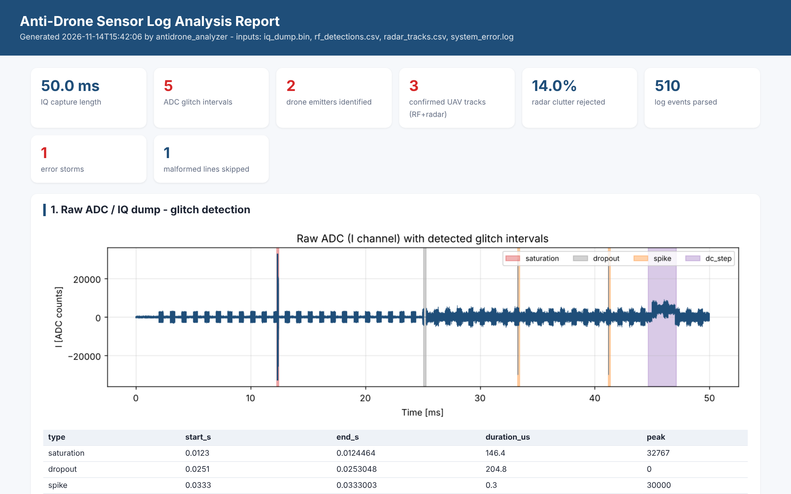
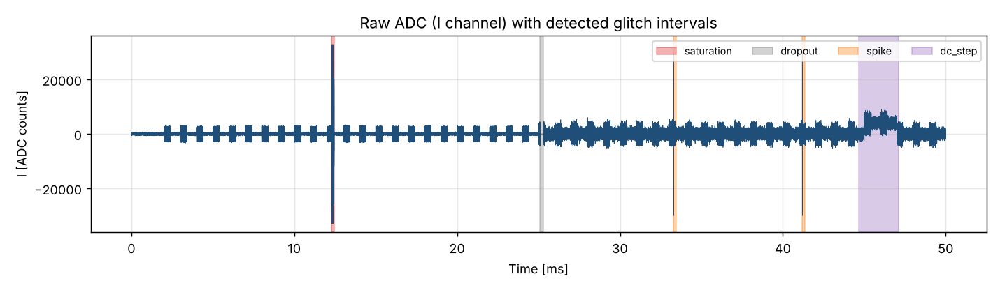
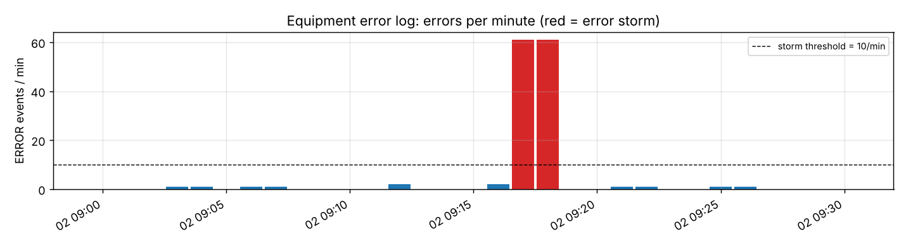

# 🛰️ Anti-Drone Sensor Log Analyzer (ADLA)

> **드론 탐지 장비의 기록(RF 원시데이터·RF/레이더 탐지 기록·장비 일지)을 자동으로 읽어서, 언제 무슨 일이 있었는지 보고서로 정리해 주는 Python 프로그램**

[](https://github.com/taeseokyoon/antidrone-log-analyzer/actions/workflows/ci.yml)
 

| 항목 | 내용 |
|---|---|
| 과목 | 인공지능특론세미나 — 기말 과제 (LLM 코딩 에이전트 활용 실습 프로젝트) |
| 작성자 | 윤태석 (기계IT융합공학 박사과정) |
| 개발 도구 | LLM 코딩 에이전트 **Claude (Claude Code 기반 에이전트)** + Python 3 |
| 과제 주제 분류 | 예시 주제 “대용량 센서 덤프 및 장비 에러 로그 분석”을 안티드론(드론 탐지) 현업 문제로 확장한 자유 주제 |

### 📋 과제 요구사항 대응표

| 과제 요구사항 | 이 저장소의 위치 |
|---|---|
| 프로젝트 개요 | [1. 프로젝트 개요](#1-프로젝트-개요) |
| 주요 기능 | [2. 주요 기능](#2-주요-기능) |
| 실행 환경 설정 및 구동 명령어 | [3. 실행 환경 설정 및 구동 명령어](#3-실행-환경-설정-및-구동-명령어) |
| 개발 과정에서 사용한 핵심 프롬프트 | [6. 개발 과정에서 사용한 핵심 프롬프트](#6-개발-과정에서-사용한-핵심-프롬프트) |
| 문제 해결 과정 | [7. 문제 해결 과정](#7-문제-해결-과정) |
| 전체 소스 코드 | [`antidrone_analyzer/`](antidrone_analyzer/) (5개 모듈), [`tests/`](tests/) |
| 샘플 입력 파일 (더미 데이터) | [`samples/`](samples/) — IQ 덤프, RF·레이더 로그, 장비 에러 로그, 정답 파일 |
| 패키지 의존성 목록 | [`requirements.txt`](requirements.txt) |
| 발표 자료 (PPTX/PDF, 10~11장) | [`docs/ADLA_presentation.pdf`](docs/ADLA_presentation.pdf) · [`docs/ADLA_presentation.pptx`](docs/ADLA_presentation.pptx) — 11장 (기획 의도·시스템 구조·LLM 활용 및 디버깅·실행 결과 화면 포함), 슬라이드 노트에 발표 대본 포함 |
| 실행 결과 화면 | [5. 실행 결과](#5-실행-결과), 샘플 리포트 [`reports/sample_report/report.html`](reports/sample_report/report.html) |
| 재현성 (다른 사람이 같은 결과 확인) | [5.4 재현성](#54-재현성--다른-사람이-같은-결과를-얻을-수-있는가) |



---

## 1. 프로젝트 개요

### 1.1 한 문장 요약
> **“드론 탐지 장비의 블랙박스 기록을 자동으로 읽어서, 언제 무슨 일이 있었는지 보고서로 정리해 주는 프로그램”**

### 1.2 기획 의도 — 왜 이 주제인가
| 근거 | 내용 |
|---|---|
| 과제의 요구 | LLM 코딩 에이전트로 **실제 업무에 쓸 수 있는 도구**를 만들고 공개하기 |
| 작성자의 현업 | 공공부문 **드론 탐지·차단 SI 사업 PM** — 장비 오탐·미탐, 장애 원인 분석을 직접 다룸 |
| 작성자의 연구 | 박사 연구 주제가 **안티드론 다중 센서(RF·레이더) 융합 기반 탐지·식별 성능 향상** |

드론 탐지 현장에는 매일 세 종류의 기록이 쌓입니다.

| 기록 | 쉬운 말 | 실제 형태 |
|---|---|---|
| 원시 IQ/ADC 덤프 | **RF 원시데이터 (IQ 데이터)** | RF 수신기가 안테나로 받은 신호를 숫자로 그대로 저장 (수백 MB ~ 수 GB) |
| RF 탐지 로그 · 레이더 트랙 로그 | **탐지 기록** | “언제, 어느 방향에, 무엇을 봤다” (CSV) |
| 장비 상태·에러 로그 | **장비 일지** | 장비가 스스로 남기는 메시지 (하루 수천 줄) |

드론을 놓치거나 새를 드론으로 잘못 알리면, 지금은 사람이 이 파일들을 하나씩 열어 시간대를 맞춰 보며 원인을 찾습니다. 시간이 많이 들고 담당자마다 결론이 다릅니다. ADLA는 이 작업을 **명령어 한 줄**로 자동화하고, 결과를 **누가 돌려도 같은 보고서**로 남깁니다.

### 1.3 프로그램이 답하는 네 가지 질문

| 현장 질문 | 프로그램의 답 (샘플 데이터 결과) |
|---|---|
| 수신기가 고장 나거나 이상했던 순간은? | RF 원시데이터에서 신호가 튀거나 끊긴 구간 표시 → 심어 둔 고장 5개 모두 찾음 |
| 드론 전파가 정말 있었나? | 드론 조종 신호 8개 채널과 영상 신호 찾음 |
| 진짜 드론이었나, 새였나? | 레이더와 RF가 함께 본 것만 드론으로 판정 → 드론 비행 3회, 새 140건 구분 |
| 장비 통신에 문제가 있었나? | 장비 일지에서 에러가 몰린 시간 표시 → 9:17~9:19 통신 에러 폭주 |

### 1.4 실제 업무 현장에 주는 도움

| 업무 상황 | 지금 (수작업) | ADLA를 쓰면 | 기대 효과 |
|---|---|---|---|
| 오탐·미탐 원인 분석 (발주처 문의 대응) | 기록 파일을 하나씩 열어 시간대를 맞춰 봄 | 원인 후보와 근거 그래프가 바로 나옴 | 분석 시간 단축, 근거 있는 답변 |
| 시험평가·준공 검사 | 탐지율·오탐률을 담당자가 직접 집계 | 같은 기준으로 자동 집계 | 객관적 성능 지표, 재검증 쉬움 |
| 운영·유지보수 장애 대응 | 현장 방문 후에야 원인 장비 파악 | 수신기 과부하·통신 에러 시간대를 먼저 확인 | 원인 장비 빠른 특정, 불필요한 출동 감소 |
| 월간 운영 보고 | 그래프·표를 손으로 다시 작성 | 보고서(HTML)·CSV를 그대로 첨부 | 보고서 작성 부담 감소 |
| 연구·신규 제안 | 실측 데이터 정리에 시간 소모 | 데이터 정리·라벨 자동화 | 연구 데이터 준비, 제안서 차별화 근거 |

> ※ 현재는 실제 형식을 흉내 낸 **가상 데이터(정답 포함)**로 검증한 단계입니다. 실제 장비에 적용하려면 장비별 파일 형식과 기준값을 현장 데이터에 맞추는 작업이 필요합니다.

---

## 2. 주요 기능

| # | 기능 | 쉬운 설명 | 기술적 방법 | 출력 |
|---|---|---|---|---|
| ① | **ADC 글리치(이상치) 탐지** | 수신 신호가 튀거나 끊긴 순간 찾기 | 청크 단위 스트리밍으로 포화(saturation)·임펄스 스파이크·드롭아웃(0 연속)·DC 오프셋 스텝 탐지 | `iq_glitches.csv`, 파형 그래프 |
| ② | **FFT 스펙트럼 분석** | 신호를 시간·주파수별로 펼친 그림(스펙트로그램) 그리기 | Welch PSD(전체 파일 누적) + Blackman-Harris 스펙트로그램 | `psd.png`, `spectrogram.png` |
| ③ | **드론 송신기 식별** | 스펙트로그램에서 드론 조종 신호·영상 신호 찾기 | 시간-주파수 연결 성분 라벨링 → FHSS 제어링크(호핑 채널·버스트 길이·주기), 광대역 영상링크(중심주파수·대역폭) 추정 | `iq_emissions.csv`, 송신기 요약 표 |
| ④ | **RF–레이더 탐지 융합** | 두 목격자(레이더·RF)의 증언 맞추기 | 시간 게이트(±1.5 s) + 방위 게이트(±12°, 0/360° 경계 처리) 연관 → 확인 UAV / 레이더 단독(조류·클러터) / RF 단독(Wi-Fi) 분류 | `uav_events.csv`, `rf_fused.csv`, 융합 그래프 |
| ⑤ | **장비 에러 로그 분석** | 장비 일지에서 에러가 몰린 시간 찾기 | 정규식 스트리밍 파싱, 분당 ERROR 건수의 강건 통계(중앙값 + 5·MAD)로 에러 폭주 구간 탐지, 깨진 줄 격리 | `error_storms.csv`, 타임라인 그래프 |
| ⑥ | **자동 리포트** | 결과를 보고서 1장으로 정리 | KPI 카드 + 그래프 + 표가 들어간 단일 HTML 파일(이미지 내장) + `summary.json` | `report.html` |
| ⑦ | **더미 데이터 생성기** | 장비 없이도 시험할 수 있는 ‘정답 있는 시험지’ | 실제 형식의 가상 데이터와 정답(`ground_truth.json`) 생성 | `samples/` |

---

## 3. 실행 환경 설정 및 구동 명령어

### 3.1 실행 환경 설정
* Python **3.10 이상** (Windows / macOS / Linux 공통, 하드웨어 불필요)
* 의존성: `numpy`, `scipy`, `pandas`, `matplotlib`, `pytest` ([`requirements.txt`](requirements.txt))

```bash
git clone https://github.com/taeseokyoon/antidrone-log-analyzer.git
cd antidrone-log-analyzer
python -m venv .venv
# Windows: .venv\Scripts\activate      macOS/Linux: source .venv/bin/activate
pip install -r requirements.txt
```

### 3.2 구동 명령어

```bash
# ① 포함된 샘플 데이터 분석 → reports/latest/report.html (브라우저로 열기)
python -m antidrone_analyzer analyze --data samples --out reports/latest

# ② 더미 데이터 새로 생성 (같은 --seed면 samples/와 똑같은 파일이 나옴. --iq-seconds로 길이 지정, 1초당 약 40 MB·생성 시 메모리 많이 사용)
python -m antidrone_analyzer generate --out my_data --iq-seconds 0.05

# ③ 개별 파일 지정 + 융합 기준 조정
python -m antidrone_analyzer analyze --iq my.bin --rf rf.csv --radar radar.csv --log sys.log \
       --dt 2.0 --gate 15 --chunk 2000000 --out reports/site_A

# ④ 테스트 (정답 대비 자동 채점 10개)
pytest -q

# ⑤ 대용량 성능 재현 (샘플을 500번 이어 붙인 1 GB 파일로 측정, 끝나면 자동 삭제)
python tools/benchmark.py              # 빠른 확인: --copies 50 (100 MB)
```

실행 예시 출력:
```
[ADLA] IQ dump   : samples/iq_dump.bin (2.0 MB) ...
[ADLA]   -> 5 glitch intervals, 2 emitters
[ADLA] RF/radar  : rf_detections.csv + radar_tracks.csv ...
[ADLA]   -> 3 confirmed UAV tracks
[ADLA] Error log : system_error.log ...
[ADLA]   -> 510 events, 1 storms, 1 malformed lines
[ADLA] done in 1.6s -> reports/latest/report.html
```

| 옵션 | 의미 | 기본값 |
|---|---|---|
| `--data` | 입력 파일 4종이 들어 있는 폴더 | `samples` |
| `--iq / --rf / --radar / --log` | 파일을 개별로 지정 | – |
| `--out` | 보고서 저장 폴더 | `reports/latest` |
| `--dt` | RF·레이더를 같은 탐지로 볼 시간 차 [초] | 1.5 |
| `--gate` | RF·레이더를 같은 탐지로 볼 방위 차 [도] | 12 |
| `--chunk` | RF 원시데이터를 한 번에 읽는 샘플 수 (메모리 사용량 조절) | 1,048,576 |

### 3.3 샘플 입력 파일 (더미 데이터)

| 파일 | 내용 · 형식 |
|---|---|
| `iq_dump.bin` (+`iq_dump.json`) | RF 원시데이터(IQ). int16 리틀엔디언 I/Q 인터리브, 10 Msps, 50 ms (2 MB) |
| `rf_detections.csv` | `timestamp, sensor_id, freq_mhz, bandwidth_mhz, rssi_dbm, protocol, bearing_deg` |
| `radar_tracks.csv` | `timestamp, track_id, range_m, azimuth_deg, elevation_m, speed_mps, rcs_dbsm` |
| `system_error.log` | `YYYY-MM-DD HH:MM:SS.mmm [LEVEL] DEVICE CODE detail` |
| `ground_truth.json` | 생성기가 일부러 심어 둔 정답 (테스트 채점용) |

샘플 시나리오: 30분 운용 기록 — 드론 3회 비행, 조류 140건, Wi-Fi 90건, 2분간 통신(CRC) 에러 폭주, 깨진 로그 1줄, 그리고 RF 원시데이터 속 고장 5건(과부하·끊김·순간 잡음 2건·기준점 틀어짐)

### 3.4 폴더 구조

```
antidrone-log-analyzer/
├── antidrone_analyzer/
│   ├── __main__.py        # 명령어 처리 (generate / analyze)
│   ├── generator.py       # 더미 데이터 + 정답(ground_truth.json) 생성
│   ├── iq_analysis.py     # RF 원시데이터 분석: 글리치 탐지, PSD, 스펙트로그램, 송신기 식별
│   ├── log_analysis.py    # 장비 일지 분석, RF-레이더 융합
│   └── report.py          # 그래프·CSV·HTML 보고서
├── samples/               # 바로 실행 가능한 샘플 입력 (2.1 MB)
├── reports/sample_report/ # 샘플 실행 결과 (HTML/CSV/PNG)
├── tests/test_pipeline.py # 정답 대비 자동 채점 + 재현성 테스트 10개
├── tools/benchmark.py     # 대용량(1 GB) 성능·정확도 재현 스크립트
├── docs/                  # 발표자료(PPTX/PDF), 이미지
├── .github/workflows/ci.yml  # GitHub Actions: 린트 + 테스트 + 샘플 보고서 자동 실행
├── requirements.txt · pytest.ini · ruff.toml
└── README.md
```

---

## 4. 시스템 구조

```
          ┌──────────────── samples/ (현장 데이터 또는 더미) ────────────────┐
          │ iq_dump.bin(+json)   rf_detections.csv   radar_tracks.csv   system_error.log │
          └──────┬──────────────────────┬───────────────────────┬───────────────┘
                 ▼                      ▼                       ▼
        iq_analysis.py           log_analysis.fuse()       log_analysis.py
   ┌──────────────────────┐   ┌────────────────────┐   ┌─────────────────────┐
   │ RF 원시데이터 분석     │   │ RF·레이더 융합       │   │ 장비 일지 분석       │
   │ read_chunk (1M 샘플)  │   │ 시간·방위 게이트     │   │ 정규식 스트리밍 파싱  │
   │ ├ detect_glitches     │   │ → 드론 / 새 / Wi-Fi │   │ find_error_storms   │
   │ ├ Welch PSD 누적      │   │   분류              │   │  (median + 5·MAD)   │
   │ └ spectrogram → 송신기 │   └─────────┬──────────┘   └──────────┬──────────┘
   └──────────┬───────────┘             │                          │
              └──────────────┬──────────┴──────────────────────────┘
                             ▼
                        report.py  →  reports/<out>/report.html + *.csv + summary.json + figures/*.png
```

---

## 5. 실행 결과

### 5.1 결과 화면

| RF 수신 신호 속 이상 순간 (색칠된 구간) | 스펙트로그램에서 찾은 드론 신호 (빨강 = 조종, 노랑 = 영상) |
|---|---|
|  |  |

| 진짜 드론(빨강) vs 새·잡음(회색) vs Wi-Fi(파랑) | 장비 일지의 통신 에러 폭주 (빨간 막대) |
|---|---|
|  |  |

### 5.2 정답 대비 검증 결과 (샘플 데이터)

| 항목 | 일부러 심어 둔 정답 | ADLA 분석 결과 |
|---|---|---|
| RF 원시데이터 속 고장(글리치) | 과부하 1, 끊김 1, 순간 잡음 2, 기준점 틀어짐 1 | **5/5 유형·구간 일치, 오경보 0** |
| 드론 조종 신호(FHSS) | 8채널(±0.5~±3.5 MHz), 버스트 0.4 ms, 주기 1.0 ms | **8채널 일치**, 버스트 0.41 ms, 주기 1.00 ms |
| 드론 영상 신호 | 중심 −4.2 MHz, 대역폭 1.6 MHz | 중심 −4.16 MHz, 대역폭 1.52 MHz |
| 드론 비행 | 3회 (09:03, 09:14, 09:22:30) | **3회 모두 확인**, 시작 시각 오차 < 1 s, 프로토콜 일치 |
| 통신 에러 폭주 | 09:17–09:19 CRC_ERROR | 09:17–09:19, `CRC_ERROR @ LINK-ETH0` |
| 깨진 로그 줄 | 1줄 | 1줄 격리, 나머지 510개 이벤트 정상 처리 |

### 5.3 대용량 성능 (1 GB RF 원시데이터 = 2.5억 샘플, 클라우드 VM 기준, `python tools/benchmark.py`로 재현)

| 항목 | 결과 |
|---|---|
| 처리 시간 | 약 83 초 (약 12 MB/s) |
| 최대 메모리 사용량 | **207 MB** (개선 전 1,154 MB → [7장](#7-문제-해결-과정) 참고) |
| 정확도 | 글리치 2,500개 = 500회 × 5유형, **누락·중복 0** |


### 5.4 재현성 — 다른 사람이 같은 결과를 얻을 수 있는가

| 항목 | 재현 방법 | 검증 근거 |
|---|---|---|
| 실험 데이터 | `samples/`에 그대로 포함. 다시 만들려면 `python -m antidrone_analyzer generate` (난수 시드 고정) | 다시 생성한 파일이 `samples/`와 **바이트 단위로 동일** — 자동 테스트로 확인 |
| 정답 | `samples/ground_truth.json` (일부러 심은 고장·드론 신호·에러 폭주 목록) | 모든 테스트가 이 정답과 비교해 채점 |
| 분석 결과 | `python -m antidrone_analyzer analyze --data samples` | 결과 예시를 `reports/sample_report/`에 포함 |
| 대용량 성능 | `python tools/benchmark.py` (1 GB) / `--copies 50` (100 MB) | 고장 검출 수가 정확히 (복사 횟수 × 정답 수)인지 자동 판정 |
| 다른 컴퓨터에서 | GitHub Actions가 push마다 **새 가상머신(Python 3.10, 3.12)**에서 설치 → 테스트 10개 → 샘플 분석 → 100 MB 벤치마크를 실행 | [Actions 실행 기록](https://github.com/taeseokyoon/antidrone-log-analyzer/actions)에서 누구나 확인 가능 |

> ※ 정확도(검출 개수·위치)는 어느 컴퓨터에서나 같게 나오지만, **처리 시간과 메모리 수치는 컴퓨터 사양에 따라 달라집니다.** (예: GitHub Actions 100 MB 기준 5.6~7.4초, 207~219 MB)

---

## 6. 개발 과정에서 사용한 핵심 프롬프트

### 6.1 개발 방식
요구사항을 자연어로 요청하면 **코딩 에이전트(Claude)가 코드 작성 → 실행 → 정답과 비교 → 원인 분석 → 수정**을 반복했습니다. 핵심 원칙은 **“정답을 아는 시험지로 채점한다”**입니다. 생성기가 고장과 드론 신호를 일부러 심을 때 정답을 `ground_truth.json`에 함께 기록하고, 분석 결과를 이 정답과 비교해 버그를 찾았습니다.

```
 ① 말로 요청  →  ② AI가 코드 작성  →  ③ 실행해서 정답과 비교  →  ④ 틀리면 원인 찾아 수정  →  ②로 반복
```

### 6.2 핵심 프롬프트 (단계별 요청 요지)

| 단계 | 프롬프트 |
|---|---|
| 기획 | “LLM 코딩 에이전트로 현업 문제 자동화 도구를 만들어 GitHub에 공개하는 기말 과제다. 주제는 **안티드론 센서 로그 분석기**로 하고, 발표자료는 PPTX와 PDF로 만들어 줘.” |
| 데이터 설계 | “하드웨어 없이 누구나 테스트할 수 있게, 실제 장비 출력 형식을 따르는 **더미 IQ 덤프·RF/레이더 로그·에러 로그**를 만들고, 일부러 넣은 결함과 드론 신호의 **정답을 JSON으로 저장**해 줘.” |
| 분석 엔진 | “GB 단위 IQ 파일을 **조금씩 나눠(청크) 읽어** 포화·스파이크·드롭아웃·DC 스텝을 찾고, 스펙트럼 분석으로 **드론 조종 신호(FHSS)와 영상 신호를 식별**해 줘.” |
| 융합·로그 | “RF 탐지와 레이더 트랙을 **시간·방위로 맞춰** 진짜 드론과 새·Wi-Fi 오탐을 나누고, 에러 로그에서는 **에러가 갑자기 몰린 구간**을 찾아 줘. 깨진 줄이 있어도 멈추지 마.” |
| 검증 | “결과를 정답과 비교하는 **자동 테스트(pytest)**를 만들고, **1 GB 파일로 속도·메모리**를 측정해 줘. 읽는 단위(청크)를 바꿔도 결과가 같아야 해.” |
| 배포·발표 | “**GitHub Actions**로 테스트를 자동 실행하고, README와 발표자료를 정리해 Public 저장소에 올려 줘.” |
| 발표 보완 | “발표자료가 너무 어려워. **쉬운 말과 비유로 다시 만들고, 왜 이 과제를 했는지와 실제 업무 현장에 어떤 도움이 되는지**도 정리해 줘.” |

---

## 7. 문제 해결 과정

### 7.1 쉬운 요약

| # | 문제 | 해결 | 결과 |
|---|---|---|---|
| 1 | 드론 신호 하나가 여러 조각으로 보임 | 스펙트럼 분석용 창함수를 더 선명한 것(Blackman-Harris)으로 교체 | 조종 신호 8채널 정확히 인식 |
| 2 | 순간 잡음 때문에 영상 신호가 화면 전체로 잡힘 | 잡음 순간을 먼저 빼고 분석 | 영상 신호 위치 정상 |
| 3 | 신호 폭이 실제보다 넓게 측정됨 | 가장자리 대신 평균 스펙트럼으로 폭 측정 | 정답과 일치 |
| 4 | 과부하 1건이 여러 조각으로 나뉨 | 가까운 조각을 하나로 이어 붙임 | 과부하 1건 정확 |
| 5 | 큰 파일(1 GB)에서 같은 고장을 두 번 셈 | 이미 찾은 구간은 다시 세지 않음 | 정답 500건과 일치 |
| 6 | 큰 파일 처리 때 메모리를 1.1 GB나 씀 | 한꺼번에 말고 조금씩 나눠 읽기 | 207 MB로 감소 |
| 7 | 보고서 표의 숫자가 뭉개지고 빈칸에 NaN 표시 | 숫자 표시 방식 수정 | 정확한 값 표시 |
| 8 | 새 PC 환경에서 테스트 실행이 안 됨 | 테스트 설정 파일 추가 | 채점자와 같은 조건에서 9개 통과 |

> 💡 **배운 점**: AI는 코드를 빠르게 만들지만, 맞는지는 **‘정답을 아는 시험지’로 채점해야** 알 수 있습니다. 위 8건 중 5건은 프로그램이 멈추지 않고 실행은 되는데 **결과만 틀린** 버그였고, 정답 비교와 대용량 테스트가 없었다면 발견하지 못했을 것입니다.

### 7.2 상세 기록 (증상 → 원인 → 해결)

| # | 증상 (실행 결과) | 원인 분석 | 해결 |
|---|---|---|---|
| 1 | 스펙트로그램에서 **“unknown” 영역 161개**, FHSS 버스트 14개만 인식 | 기본 창함수(Tukey)의 **스펙트럼 누설**로 강한 호핑 톤 하나가 인접 bin 여러 조각으로 분리 | **Blackman-Harris 창**(사이드로브 약 −92 dB) + 주파수 방향 closing(5 bin)으로 조각 병합 |
| 2 | 영상링크가 **중심 0 MHz, 대역폭 10 MHz**로 잘못 측정 | 스파이크·포화 프레임이 전 대역을 덮어 영상 대역과 모든 신호를 **하나의 연결 성분으로 이어 붙임** | 활성 bin이 50%를 넘는 프레임을 **광대역 과도(broadband transient)**로 먼저 분리한 뒤 라벨링 → −4.16 MHz / 1.52 MHz |
| 3 | FHSS 버스트 대역폭이 **약 1 MHz**로 과대 추정 (실제 단일 톤) | 버스트 on/off 경계 프레임에서 에너지가 퍼지는 현상(splatter) → 경계 상자 폭이 넓어짐 | 성분별 **시간 평균 스펙트럼의 −10 dB 폭**으로 대역폭 계산 → 8개 호핑 채널 전부 정답과 일치 |
| 4 | 포화 구간 1개가 **포화 1 + 스파이크 4개**로 쪼개짐 | 과부하 구간 안에서도 포락선이 임계값(0.7 FS) 아래로 수백 샘플씩 내려감 → 32샘플 closing으로는 이어 붙지 않음 | closing 구조 요소를 **256샘플**로 확대 → 포화 1개로 정확히 탐지 |
| 5 | 1 GB 테스트에서 DC 스텝이 **500개가 아닌 559개** | 처음엔 청크 경계 문제로 의심했으나, 위치를 출력해 보니 **포화 구간마다** 추가 검출. 클리핑된 대진폭 잡음의 블록 평균이 0에서 벗어남 | 포화·스파이크·드롭아웃이 포함된 블록은 DC 판정에서 **제외** → 500개 정확 |
| 6 | 1 GB 처리 시 메모리 **1,154 MB** (스트리밍 설계 의도와 불일치) | `np.memmap`으로 접근한 페이지가 모두 RSS로 집계됨 | 청크마다 `np.fromfile(offset=…)`로 **명시적으로 읽기** → **207 MB** |
| 7 | 리포트 표의 시간 값이 `0.012`로 뭉개지고 NaN이 그대로 표시됨 | 고정 소수점 3자리 포맷, 송신기 유형별로 열 구성이 다름 | 유효숫자 6자리 포맷, 빈 값은 공란 처리 |
| 8 | 새로 clone한 깨끗한 가상환경에서 `pytest` 실행 시 `ModuleNotFoundError` | 개발 중에는 `python -m pytest`로 실행해 현재 폴더가 import 경로에 자동 포함되었음 (README·CI의 `pytest`와 다른 조건) | `pytest.ini`에 `pythonpath = .` 추가 → 채점자와 같은 조건(fresh clone + venv)에서 9 passed |

---

## 8. 한계 및 향후 과제
* 샘플은 **가상(합성) 데이터**입니다. 실제 SDR(USRP, HackRF 등) 캡처에 적용하려면 기준값을 현장 잡음 수준에 맞게 다시 보정해야 합니다.
* 드론 신호 분류는 규칙 기반입니다. 향후 스펙트로그램 기반 **딥러닝 분류기**(DJI OcuSync, ELRS, Wi-Fi 등)로 확장할 예정입니다.
* 융합은 가장 가까운 탐지끼리 짝짓는 방식입니다. **칼만 필터 기반 트랙 융합**과 다중 표적 연관(JPDA/GNN) 적용이 필요합니다.
* 샘플에서 Wi-Fi 탐지 3건이 드론 비행 시간·방위와 우연히 겹쳐 드론으로 분류됐습니다. 프로토콜 정보 가중치로 개선할 수 있습니다.

## 9. 라이선스
MIT License — 교육·연구 목적으로 자유롭게 사용할 수 있습니다.
